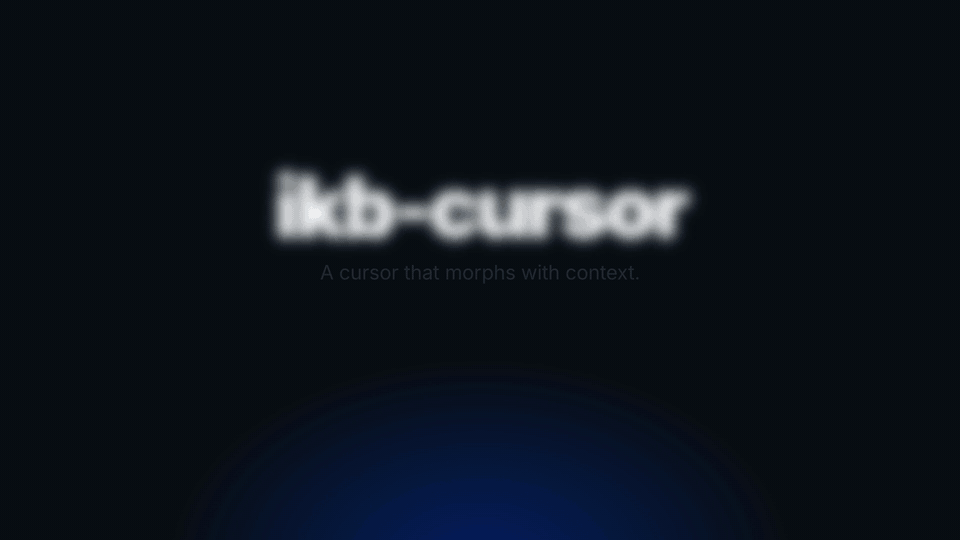

# ikb-cursor



A macOS cursor replacement: a circle (white by default, any colour via a config file; International Klein Blue `#002FA7` shown in the name) that follows the pointer and morphs with the context.

- **Default:** 14 px dot
- **Over buttons, links, menu items:** grows to a 20 px ring (85% opacity)
- **Over text fields:** turns into a thin vertical bar
- **While pressed:** shrinks

Smooth animated transitions, ~1% CPU when the mouse is idle.

## How it works

1. All system cursors are replaced with fully transparent ones through the private CoreGraphics (`CGS*`) cursor API, including the Dock override, so no arrow shows under the circle.
2. A transparent click-through overlay window draws the circle at the pointer position.
3. The element under the pointer is found with the Accessibility API (the window list is used to skip the overlay itself) to pick the shape.

## Requirements

- macOS 26+ (Tahoe) on Apple Silicon, tested on macOS 27
- Xcode command line tools (`swiftc`)
- **Accessibility permission** for the built binary (needed to detect text fields / buttons; without it you only get the plain dot)

## Install

```sh
git clone https://github.com/mrundeville-hub/ikb-cursor
cd ikb-cursor
./install.sh
```

Then allow the printed binary in **System Settings → Privacy & Security → Accessibility** (drag the file into the list and switch it on), and restart it once:

```sh
launchctl kickstart -k gui/$(id -u)/local.ikb-cursor
```

Change the colour any time without rebuilding (default white, hot-reloaded within ~2 s):

```sh
echo 002FA7 > ~/.config/ikb-cursor/color   # International Klein Blue
```

Uninstall: `launchctl bootout gui/$(id -u)/local.ikb-cursor && rm ~/Library/LaunchAgents/local.ikb-cursor.plist && ./ikb-cursor --restore`

## Build and run

```sh
./build.sh
./ikb-cursor            # run in foreground
./ikb-cursor --restore  # restore the default system cursors
```

Autostart at login (installs a LaunchAgent):

```sh
./install.sh
```

Then add the printed binary path to System Settings → Privacy & Security → Accessibility. Note: every rebuild changes the ad-hoc signature, so macOS may reset that permission; remove and re-add the entry if shapes stop morphing.

Stop and restore: `launchctl bootout gui/$(id -u)/local.ikb-cursor` (or `pkill ikb-cursor`), then `./ikb-cursor --restore` if the cursor is invisible.

## Caveats

- Uses **private, undocumented** macOS APIs. They can change or break in any macOS update.
- Some full-screen apps and games may show the system cursor.
- If the process is killed uncleanly, run `./ikb-cursor --restore`.

## The promo video

`promo/` is a [HyperFrames](https://hyperframes.heygen.com) project (HTML → video). Render it with `cd promo && npm run render`.

## Credits

The sequence of private CGS calls used to replace system cursors on macOS Tahoe is based on the approach in the open-source [MaCursor](https://github.com/writronic/MaCursor) (GPL-3.0). No code was copied; the calls were re-implemented independently.

## License

MIT, see [LICENSE](LICENSE).
